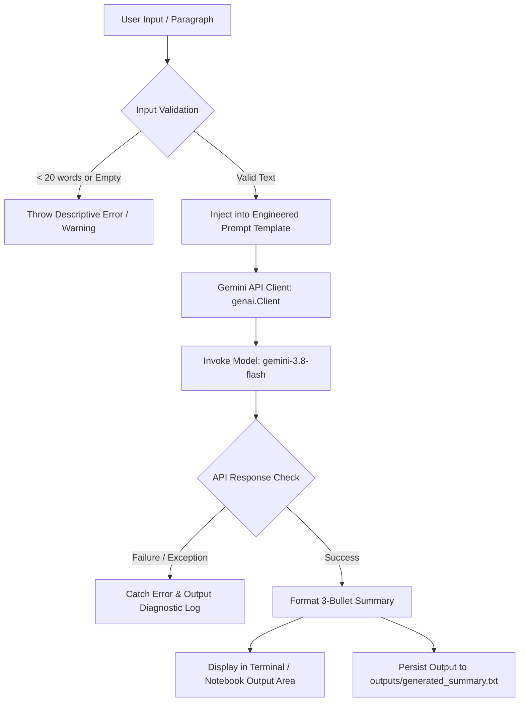

# 🧠 Gemini AI Text Summarizer (LLM API Summarizer)

[](https://www.python.org/)
[](https://github.com/google-gemini/google-genai)
[](https://ai.google.dev/)
[](LICENSE)
[](https://github.com/SyedMuaarij-Nadeem/week-6-LLM-API-Summarizer)

An AI-powered text summarization utility built with Google's state-of-the-art **Gemini API** using the next-generation **Google GenAI SDK** (`google-genai`). Engineered with strict prompt-level constraints, this project transforms lengthy paragraphs and dense text into clean, high-density, three-bullet summaries without hallucinations or conversational filler.

Developed as part of the **DataNex AI/ML Internship (Week 6: LLM API Integration)**.

---

## 📑 Table of Contents

- [Overview](#-overview)
- [Key Features](#-key-features)
- [System Architecture & Workflow](#-system-architecture--workflow)
- [Prompt Engineering Strategy](#-prompt-engineering-strategy)
- [Tech Stack](#-tech-stack)
- [Project Directory Structure](#-project-directory-structure)
- [Prerequisites & Installation](#-prerequisites--installation)
- [API Key Setup](#-api-key-setup)
- [Usage Guide](#-usage-guide)
  - [1. CLI Mode (`src/summarizer.py`)](#1-cli-mode-srcsummarizerpy)
  - [2. Interactive Notebook (`notebooks/01_gemini_api_summarizer.ipynb`)](#2-interactive-notebook-notebooks01_gemini_api_summarizeripynb)
- [Example Demonstrations](#-example-demonstrations)
- [Defensive Programming & Error Handling](#-defensive-programming--error-handling)
- [Security & Best Practices](#-security--best-practices)
- [Troubleshooting](#-troubleshooting)
- [Future Roadmap](#-future-roadmap)
- [Author & Acknowledgments](#-author--acknowledgments)

---

## 🌟 Overview

In the era of information abundance, extracting core takeaways from dense articles, research drafts, and industry reports is crucial. Generic LLM prompts often yield verbose, unpredictable, or hallucinated responses loaded with conversational preambles (e.g., *"Sure, here is your summary..."*).

The **Gemini AI Text Summarizer** solves this problem by pairing Google's ultra-fast `gemini-3.8-flash` model with rigid, deterministic prompt engineering rules. It delivers:
- **Consistent Structure:** Always outputs exactly three concise, single-idea bullet points.
- **Contextual Grounding:** Eliminates hallucinations by restricting output strictly to the provided source text.
- **Dual Execution Interfaces:** A production-style command-line interface (CLI) for terminal environments and an interactive Jupyter widget GUI for rapid prototyping in Google Colab.

---

## ✨ Key Features

- **Strict 3-Bullet Constraint:** Enforces concise synthesis of complex texts into exactly three informative bullet points.
- **Zero-Preamble Output:** Eliminates conversational overhead, introductions, conclusions, or metadata—pure factual synthesis only.
- **Next-Gen Google GenAI SDK:** Implements the official unified `google-genai` Python client library (`from google import genai`).
- **Defensive Input Validation:** Pre-validates user inputs before dispatching API requests, checking for empty strings and insufficient word counts (minimum 20 words) to conserve quota.
- **Interactive UI (IPython Widgets):** Provides an interactive web-like widget interface in Jupyter / Colab notebooks featuring a live textarea, status notifications, and one-click execution.
- **Automated Output Persistence:** Programmatically writes generated summaries to the `outputs/` directory (`generated_summary.txt`) for auditing, review, and downstream automation.
- **Robust Error Handling:** Catches and isolates missing environment variables, network failures, empty model responses, and malformed queries gracefully.

---

## 🏗️ System Architecture & Workflow

The pipeline ingests raw text, verifies its structure, applies constrained prompt engineering, and interfaces with the Gemini API:



### Execution Steps
1. **Client Initialization:** Securely fetches `GEMINI_API_KEY` from environment variables or Google Colab Secrets and instantiates `genai.Client`.
2. **Text Validation:** Strips whitespace and calculates token/word density to ensure the input contains sufficient information to summarize.
3. **Structured Prompt Construction:** Wraps the text inside a specialized instruction template enforcing bullet quotas, brevity, and zero hallucination.
4. **Generation & Verification:** Calls `client.models.generate_content(...)`. If the model output is empty or raises an exception, the system catches the error cleanly.
5. **Presentation & Storage:** Prints the structured summary to standard output or markdown viewer, followed by automated disk persistence.

---

## 🎯 Prompt Engineering Strategy

The core intelligence of the summarizer relies on deterministic few-shot/zero-shot instruction tuning via the system prompt:

```text
You are a professional text summarization assistant.

Your task is to summarize the provided text.

Rules:
1. Produce exactly 3 bullet points.
2. Each bullet should contain one important idea.
3. Keep each bullet concise and informative.
4. Do not add information that is not present in the text.
5. Return only the 3 bullet points.
6. Do not include an introduction or conclusion.

TEXT:{text}
```

### Why This Design Works:
| Rule Element | Technical Purpose |
| :--- | :--- |
| **Persona Assignment** (`professional assistant`) | Calibrates tone, objective language, and formal output phrasing. |
| **Strict Count Constraint** (`Rule 1 & 5`) | Eliminates variable output lengths, ensuring predictable deterministic formatting. |
| **Atomicity** (`Rule 2`) | Prevents compound sentences that try to cram unrelated topics into a single line. |
| **Negative Constraints** (`Rule 4 & 6`) | Actively mitigates hallucination and suppresses conversational noise (e.g., *"Here is your summary"*). |

---

## 🛠️ Tech Stack

| Component | Technology | Description |
| :--- | :--- | :--- |
| **Language** | [Python 3.10+](https://www.python.org/) | Core application and scripting runtime |
| **LLM Model** | [Gemini 3.8 Flash](https://ai.google.dev/) | High-speed, cost-efficient multimodal LLM from Google |
| **Official SDK** | [`google-genai`](https://pypi.org/project/google-genai/) | Modern, unified Google GenAI Python SDK |
| **Interactive GUI** | [`ipywidgets`](https://ipywidgets.readthedocs.io/) | Dynamic notebook widgets (Textarea, Button, Output) |
| **Environment** | Jupyter / Google Colab / Local CLI | Cross-platform execution compatibility |
| **Version Control** | Git & GitHub | Source tracking and team collaboration |

---

## 📁 Project Directory Structure

```plaintext
week-6-LLM-API-Summarizer/
├── .gitignore                          # Excludes venv, pycache, .env, secrets, and checkpoints
├── README.md                           # Comprehensive documentation (this file)
├── requirements.txt                    # Python package dependencies (google-genai)
├── notebooks/
│   └── 01_gemini_api_summarizer.ipynb  # Interactive Colab notebook with ipywidgets UI & auto-save
├── outputs/
│   ├── generated_summary.txt           # Latest runtime output saved by the application
│   └── sample_summary.txt              # Benchmark input/output sample for verification
└── src/
    └── summarizer.py                   # Standalone, production-ready CLI summarizer script
```

### File Breakdown:
- **`src/summarizer.py`**: The main Python CLI program. Contains modular functions:
  - `create_client()`: Reads environment variables and initializes the Gemini client.
  - `validate_text(text)`: Validates input length and sanitizes inputs.
  - `summarize_text(client, text)`: Assembles the prompt, invokes the model, and handles API exceptions.
  - `main()`: Interactive CLI loop with formatted console headers.
- **`notebooks/01_gemini_api_summarizer.ipynb`**: Complete end-to-end interactive notebook configured for Google Colab and local Jupyter. Includes dependency resolution, Google Drive integration, secret loading, and widget-based interactive testing.
- **`outputs/sample_summary.txt`**: Serves as a reference input-to-output test case demonstrating expected behavior.
- **`outputs/generated_summary.txt`**: File target for runtime outputs automatically saved during notebook execution.

---

## ⚙️ Prerequisites & Installation

### 1. Clone the Repository
```bash
git clone https://github.com/SyedMuaarij-Nadeem/week-6-LLM-API-Summarizer.git
cd week-6-LLM-API-Summarizer
```

### 2. Create and Activate a Virtual Environment

**On Windows (PowerShell):**
```powershell
python -m venv venv
.\venv\Scripts\Activate.ps1
```

**On Windows (Command Prompt):**
```cmd
python -m venv venv
.\venv\Scripts\activate.bat
```

**On macOS / Linux:**
```bash
python3 -m venv venv
source venv/bin/activate
```

### 3. Install Required Dependencies
```bash
pip install --upgrade pip
pip install -r requirements.txt
```

*(Optional: If running the interactive notebook locally, ensure Jupyter and ipywidgets are installed):*
```bash
pip install jupyter ipywidgets
```

---

## 🔑 API Key Setup

To use the Google Gemini API, you need an API key from Google AI Studio.

1. Navigate to **[Google AI Studio](https://aistudio.google.com/)**.
2. Sign in with your Google Account and click **"Get API key"**.
3. Create a new key in a project and copy it.

### Setting the Environment Variable

#### Option A: Windows (PowerShell)
```powershell
# Set for the current PowerShell session:
$env:GEMINI_API_KEY="your_actual_api_key_here"

# Or persist across all future sessions:
[System.Environment]::SetEnvironmentVariable('GEMINI_API_KEY', 'your_actual_api_key_here', 'User')
```

#### Option B: Windows (Command Prompt)
```cmd
set GEMINI_API_KEY=your_actual_api_key_here
```

#### Option C: macOS / Linux (Bash or Zsh)
```bash
export GEMINI_API_KEY="your_actual_api_key_here"
# To persist, add the above line to your ~/.bashrc or ~/.zshrc file
```

#### Option D: Google Colab Secrets (for Notebooks)
1. Open the notebook in Google Colab.
2. In the left sidebar, click the **Secrets** icon (🔑).
3. Add a new secret named `GEMINI_API_KEY` and paste your key.
4. Enable the toggle switch for **"Notebook access"**.

---

## 🚀 Usage Guide

### 1. CLI Mode (`src/summarizer.py`)

Run the standalone CLI script directly from your terminal:

```bash
python src/summarizer.py
```

**Interactive Terminal Session:**
```text
============================================================
           GEMINI AI TEXT SUMMARIZER
============================================================

Enter a long paragraph to summarize:

Artificial intelligence is being adopted across many industries to automate tasks, analyze data, improve customer experiences, and support decision-making. Machine learning allows systems to learn patterns from data, while deep learning uses neural networks for more complex tasks. Generative AI can create text, images, code, and other content. Organizations must also consider privacy, security, bias, reliability, and responsible AI practices.

Generating summary...

============================================================
SUMMARY
============================================================
* AI is actively transforming industries by automating processes, analyzing large datasets, and elevating customer experiences and decision-making.
* Core technological pillars including machine learning, deep learning, and generative AI enable systems to recognize patterns and synthesize original content.
* Scaled AI deployment requires strict organizational adherence to privacy, data security, algorithmic fairness, and ethical governance.
```

---

### 2. Interactive Notebook (`notebooks/01_gemini_api_summarizer.ipynb`)

1. Start Jupyter:
   ```bash
   jupyter notebook notebooks/01_gemini_api_summarizer.ipynb
   ```
2. Or upload the notebook to **[Google Colab](https://colab.research.google.com/)**.
3. Execute the setup cells to load dependencies and verify credentials.
4. Interact with the rich GUI widget:
   - Paste any paragraph into the multi-line text input field.
   - Click the green **"Generate & Save Summary"** button.
   - The summary will render instantly in formatted Markdown.
   - A copy is automatically written to `outputs/generated_summary.txt`.

---

## 📊 Example Demonstrations

### Sample Benchmark 1: Artificial Intelligence Deployment

#### Source Text:
> *"Artificial intelligence is being adopted across many industries to automate tasks, analyze data, improve customer experiences, and support decision-making. Machine learning allows systems to learn patterns from data, while deep learning uses neural networks for more complex tasks. Generative AI can create text, images, code, and other content. Organizations must also consider privacy, security, bias, reliability, and responsible AI practices."*

#### Generated 3-Bullet Summary:
- • **Industrial Integration:** AI is increasingly utilized across sectors for automated workflows, big-data analytics, optimized customer journeys, and enhanced decision support.
- • **Underlying Architectures:** Machine learning, deep neural networks, and generative AI provide the technical foundation to recognize patterns and generate synthetic media.
- • **Governance & Ethics:** Responsible organizational adoption demands rigorous oversight of security, user privacy, model bias, and operational reliability.

---

### Sample Benchmark 2: Cultivating Creativity & Skill Acquisition

#### Source Text:
> *"Many people believe creativity is an innate spark given to a lucky few, but cognitive research shows that creative thinking is a disciplined, deliberate skill that can be strengthened through practice. By embracing constraints, generating a massive volume of work without fear of early failure, and combining knowledge across disparate domains, anyone can develop breakthrough solutions. Consistent execution and shipping finished work matter far more than waiting for a moment of inspiration."*

#### Generated 3-Bullet Summary (from `outputs/generated_summary.txt`):
- * Creativity is a long-term, deliberate process developed through consistent practice and effort rather than an isolated "eureka" moment.
- * Creative thinking is largely a trainable skill that relies on a growth mindset and the willingness to risk failure or embarrassment, rather than extreme intelligence or purely fixed genetics.
- * Individuals can actively boost their creativity by using constraints, producing a high volume of work, broadening their knowledge, prioritizing sleep and nature, and consistently finishing and shipping their work.

---

## 🛡️ Defensive Programming & Error Handling

The application is engineered with resilience against common failure modes:

| Scenario | Handled By | Behavior |
| :--- | :--- | :--- |
| **Missing API Key** | `create_client()` | Raises explicit `ValueError: GEMINI_API_KEY environment variable is not set.` |
| **Empty Input** | `validate_text()` | Raises `ValueError: Text cannot be empty.` |
| **Input Too Short (<20 words)** | `validate_text()` | Raises `ValueError: Please provide at least 20 words for summarization.` |
| **API Network / Auth Error** | `summarize_text()` | Catches `Exception as error` and safely returns formatted diagnostic message without crashing. |
| **Empty Model Output** | `summarize_text()` | Detects null or empty response objects and raises descriptive `RuntimeError`. |

---

## 🔒 Security & Best Practices

- **Never Commit Secrets:** The `.gitignore` is pre-configured to ignore `.env`, `*.key`, `secrets/`, and `credentials/`.
- **Environment Isolation:** API keys are never hardcoded into scripts or notebooks. They are loaded dynamically via `os.getenv` or `google.colab.userdata`.
- **Clean Git History:** Ensures no credentials or intermediate Colab checkpoints (`.ipynb_checkpoints/`) pollute the remote repository.

---

## ❓ Troubleshooting

### 1. `ValueError: GEMINI_API_KEY environment variable is not set.`
- **Solution:** Verify that you have exported or set the environment variable in the active terminal window before running `python src/summarizer.py`. If using Windows GUI settings, restart your terminal.

### 2. `google-colab requires google-auth==2.49.0 conflict`
- **Solution:** When running inside Google Colab, pin the compatible auth version as documented in the notebook:
  ```bash
  !pip install -q google-auth==2.49.0
  !pip install -q -U google-genai
  ```

### 3. Rate Limit / Quota Exceeded (HTTP 429)
- **Solution:** The free tier of the Gemini API has requests-per-minute (RPM) limits. Wait 60 seconds before submitting a new query, or check your quota usage in the [Google Cloud / AI Studio Console](https://aistudio.google.com/).

---

## 🗺️ Future Roadmap

- [ ] **Document Ingestion:** Support direct ingestion of `.pdf`, `.docx`, and `.txt` files.
- [ ] **Recursive Chunking (Map-Reduce):** Integrate chunking algorithms to summarize book-length manuscripts exceeding context limits.
- [ ] **Streamlit / Web App:** Deploy an interactive frontend interface using Streamlit or Gradio.
- [ ] **Multi-Format Export:** Add one-click export to Markdown, PDF, and JSON schemas.
- [ ] **Configurable Constraints:** Enable user-selectable summary length (e.g., 1-bullet elevator pitch, 5-bullet executive memo).

---

## 👤 Author & Acknowledgments

- **Author:** [Syed Muaarij Nadeem](https://github.com/SyedMuaarij-Nadeem)
- **Internship:** DataNex AI/ML Internship (Week 6 Project)
- **API Provider:** [Google DeepMind / Google AI Studio](https://ai.google.dev/) for the Gemini 3.8 Flash model and `google-genai` SDK.

---

## 📜 License

This project is open-source and available under the [MIT License](LICENSE).